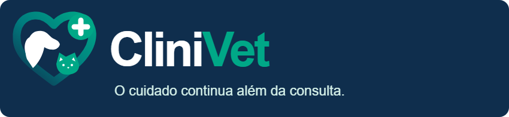
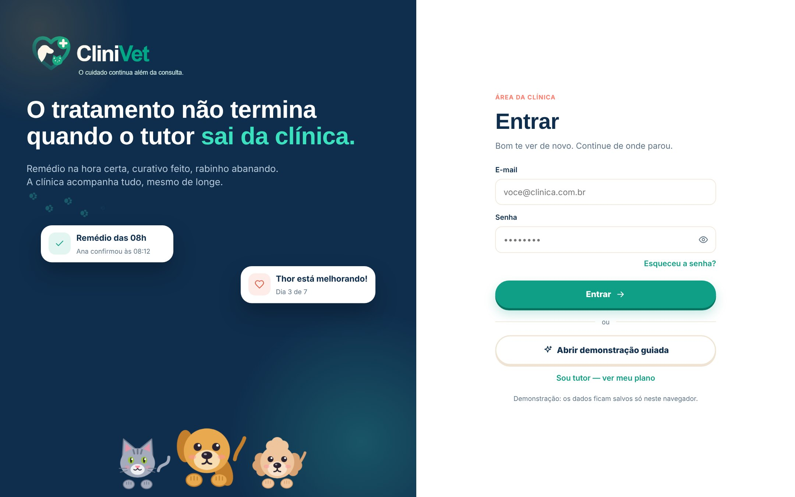
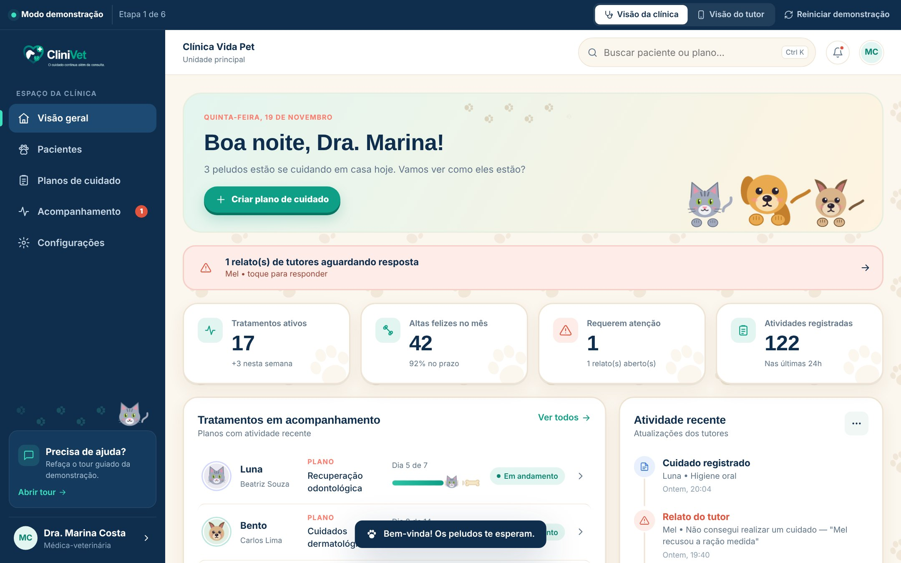
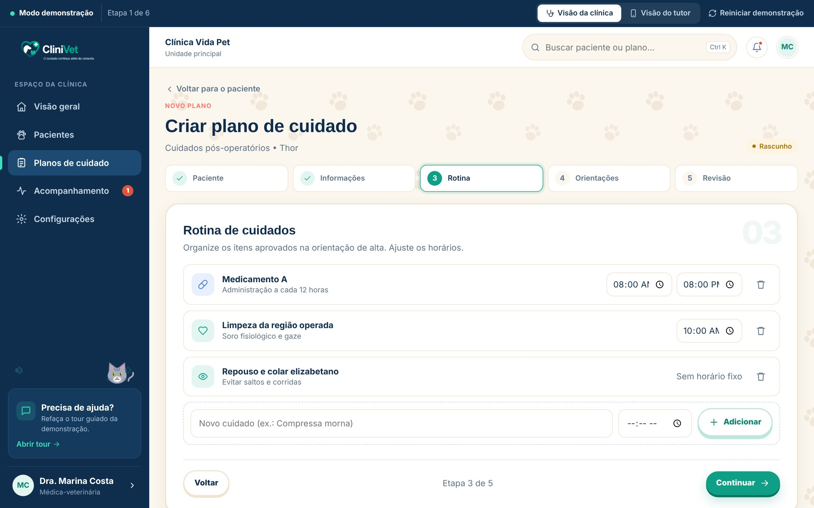
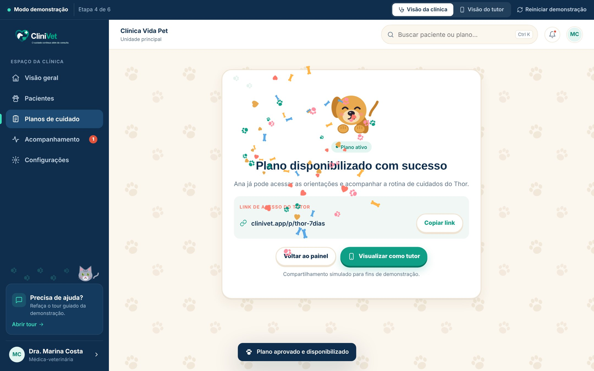
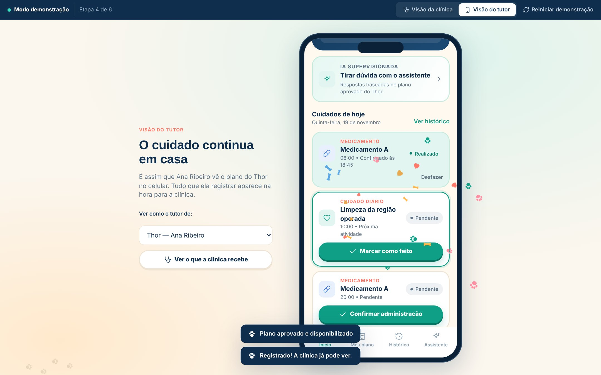
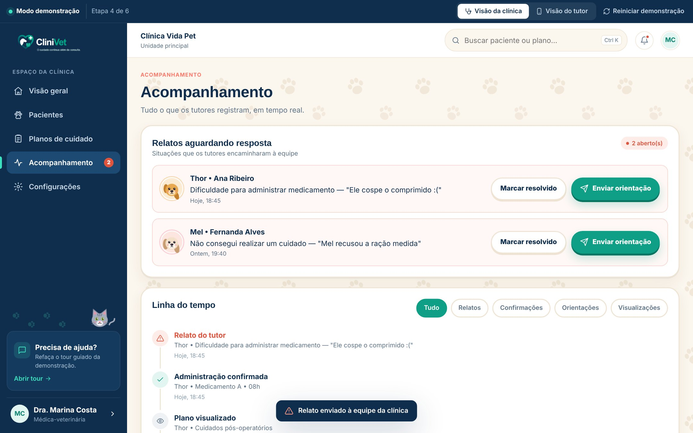

<p align="center">
  
</p>

<p align="center"><b>O cuidado continua além da consulta.</b></p>

---

## Por que eu fiz isso

Quem tem pet já passou por isso: o bicho faz uma cirurgia, a veterinária explica tudo com calma na hora da alta, entrega um papel cheio de horários… e em casa a gente esquece metade. Que remédio era às 20h? Podia tirar o colar? Será que eu ligo pra clínica ou é exagero?

E do outro lado, a clínica perde o contato com o paciente assim que ele sai pela porta. Ninguém sabe se o tratamento está sendo seguido até o retorno — quando às vezes já é tarde.

A **CliniVet** nasceu dessa ideia: transformar as orientações de alta em um **plano de cuidado digital**, que o tutor acompanha pelo celular e a clínica acompanha em tempo real.

> Projeto acadêmico desenvolvido para a faculdade.

---

## Como funciona (a história do Thor)

O Thor é um golden de 4 anos que acabou de passar por uma cirurgia. A demonstração conta a história dele em 6 etapas:

1. **A veterinária abre o painel** e vê todos os peludos que estão se tratando em casa.
2. **Abre o perfil do Thor**, que acabou de receber alta.
3. **Monta o plano em 5 passos**: paciente → período → rotina com horários → orientações → aprovação.
4. **A tutora (Ana) recebe um link.**
5. **No celular**, a Ana marca cada remédio dado, lê as orientações e, se tiver dificuldade, pede ajuda.
6. **O pedido chega na hora para a clínica**, que responde — e a resposta aparece no celular da Ana.

---

## Fotos do projeto

### Tela de entrada


### Painel da clínica
Os pets ficam "espiando" no topo. Dá pra clicar neles (eles respondem 🐾).


### Criando um plano de cuidado


### Plano aprovado


### O app do tutor
A barrinha mostra o Thor andando até o ossinho conforme o tratamento avança.


### Acompanhamento — os relatos chegando na clínica


---

## O que dá pra fazer

- Painel com os tratamentos ativos, alertas e o que os tutores registraram
- Busca de pacientes e planos (atalho `Ctrl + K`)
- Criar plano de cuidado em 5 etapas, ajustando horários e adicionando cuidados
- App do tutor: confirmar cuidados, ver orientações, histórico e pedir ajuda
- Assistente com perguntas prontas (é simulado — não é uma IA de verdade e não substitui o veterinário)
- Relatos dos tutores chegam na clínica, que responde com uma orientação
- Tour guiado pela demonstração
- Funciona no celular

E umas coisinhas que eu fiz questão de colocar, porque o projeto é sobre bicho:

- Os pets são desenhados no código (SVG): piscam, mexem a orelha, abanam o rabo e põem a língua pra fora
- Clicou no pet? Ele late ou mia
- Confete de patinhas e ossinhos quando um cuidado é confirmado
- Um gato dormindo quando a lista está vazia 😴

---

## Tecnologias

Escolhi manter simples, sem ferramenta de build:

- **HTML, CSS e JavaScript**
- **[Preact](https://preactjs.com/) + [htm](https://github.com/developit/htm)** — parecido com React, mas bem leve, e roda direto no navegador
- **Node.js** só para servir os arquivos (`server.js`, sem dependências)
- **Sem banco de dados**: os dados são de demonstração e ficam salvos no navegador (`localStorage`)

---

## Como rodar

**Opção 1 — Node**
```bash
git clone https://github.com/Vuheff/CliniVet.git
cd CliniVet
npm start
```
Depois é só abrir `http://localhost:3000`.

**Opção 2 — VS Code**
Abra a pasta, clique com o botão direito em `public/index.html` → **Open with Live Server**.

> Não abra o `index.html` com dois cliques: o navegador bloqueia os módulos JavaScript fora de um servidor.

**Deploy:** o projeto já roda no Railway (ou Render, etc.). Ele detecta o `package.json` e usa `npm start`.

---

## Organização das pastas

```
CliniVet/
├── server.js            → servidor simples (Node)
├── package.json
├── docs/screenshots/    → as fotos deste README
└── public/
    ├── index.html
    ├── assets/          → logo
    ├── css/styles.css   → todo o visual
    ├── vendor/          → Preact
    └── js/
        ├── app.js       → decide qual tela mostrar
        ├── data.js      → pets, tutores e planos de exemplo
        ├── acoes.js     → o que cada botão faz
        ├── clinica.js   → telas da veterinária
        ├── wizard.js    → "criar plano" em 5 etapas
        ├── tutor.js     → app do tutor
        ├── pets.js      → os bichinhos desenhados
        ├── fx.js        → confete de patinhas
        ├── tour.js      → tour guiado
        ├── login.js
        └── core.js      → estado, rotas e componentes
```

---

## Limitações (sendo sincero)

- É uma **demonstração**: o login não é real, e os dados ficam só no navegador de quem está usando.
- O assistente tem respostas pré-programadas.
- Pra virar produto de verdade, faltaria um back-end com banco de dados, login de verdade e notificações.

---

<p align="center">
  Feito por <b>Vitor</b> 🐾<br/>
  <sub>Projeto acadêmico — CliniVet</sub>
</p>
